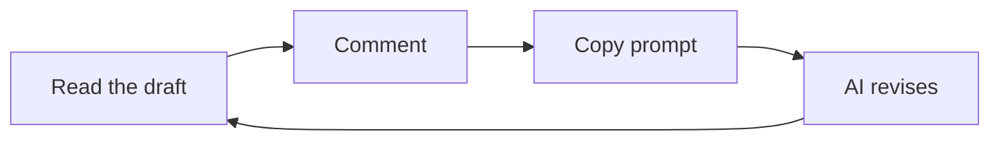

# Welcome to Review Pen

Review Pen turns your review of a long document into **one precise prompt** for the AI that wrote it. Every comment you leave carries its exact location, so the AI changes the right sentence and nothing else.

This page is a practice document. Try the steps below on it. Your comments are saved in this browser only.

## 1. Leave your first comment

Select any words in this paragraph, then press **C** (or click **Comment** in the bar that appears). Pick an intent such as *Rewrite* or *Shorten*, write what you want, and press Ctrl+Enter.

Here is a sentence that is far too long and repeats itself, because it says the same thing more than once, which is repetitive and says the same thing again.

> [!TIP]
> Hover over any paragraph and click the **+** in the left margin to comment on the whole paragraph. On a heading, the **+** selects the entire section.

## 2. Widen a selection

Put your cursor inside a word and press **Alt + ↑** a few times. The selection grows from the word, to the sentence, to the paragraph, to the section, to the whole document. **Alt + ↓** steps back. Alt + scroll does the same.

- First item in a list
- Second item, with a [link](https://example.com)
- Third item

## 3. Exact text or instruction

In the comment box, switch to **Exact text** when you know the precise wording you want. The prompt will tell the AI to swap it in character for character. Use **Instruction** when you want the AI to decide the wording.

| Feature | Instruction | Exact text |
| --- | --- | --- |
| Who chooses the words | The AI | You |
| Best for | Tone, structure, ideas | Names, numbers, quotes |

## 4. Copy the prompt

Open the **Prompt** tab on the right. Choose a format:

1. **Coding agent** for Claude Code or Cursor: file path, line numbers and find-and-replace blocks.
2. **Chat model** for Claude, ChatGPT or Gemini: clear XML blocks and guardrails.
3. **JSON or YAML** for your own scripts.

Then click **Copy prompt** at the top right, or press Ctrl+Shift+C, and paste it into your AI tool.

## 5. Code, math and diagrams

```python
def greet(name: str) -> str:
    return f"Hello, {name}!"
```

The area of a circle is $A = \pi r^2$, and a sum looks like this:

$$
\sum_{k=1}^{n} k = \frac{n(n+1)}{2}
$$



## 6. עברית וטקסט מימין לשמאל

Review Pen תומך בעברית. הפסקה הזו נכתבה מימין לשמאל, ואפשר לסמן בה מילים, משפטים ופסקאות בדיוק כמו באנגלית. גם טקסט מעורב, כמו Claude Code או GitHub, נשאר במקומו.

- פריט ראשון ברשימה
- פריט שני ברשימה

## 7. Your data stays here

Review Pen never calls an AI service and never sends your documents anywhere. The prompt is built on your computer, and the same comments always produce the same prompt.
